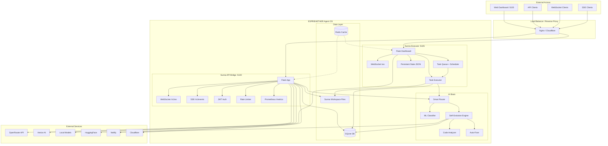
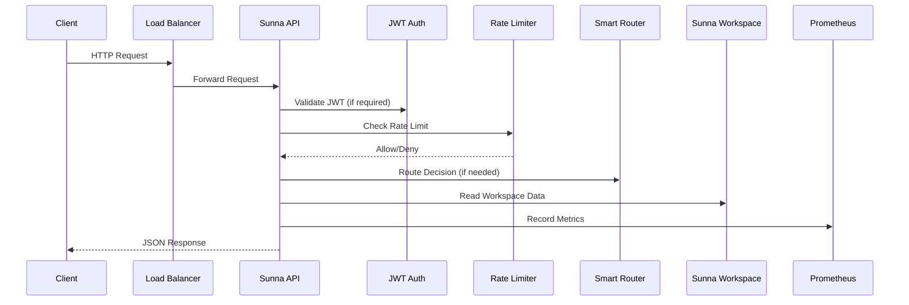
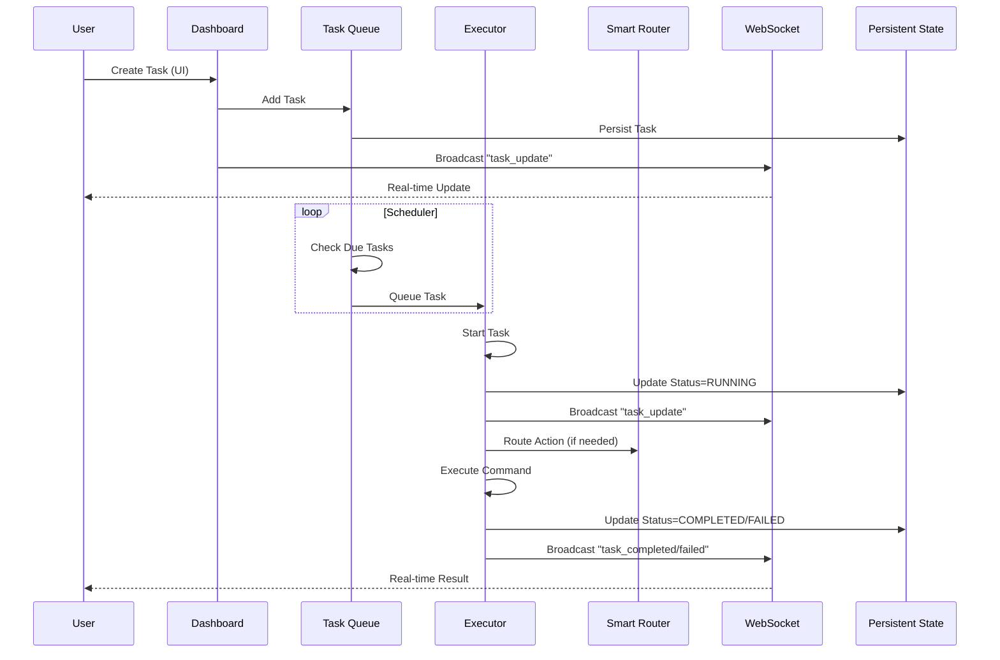
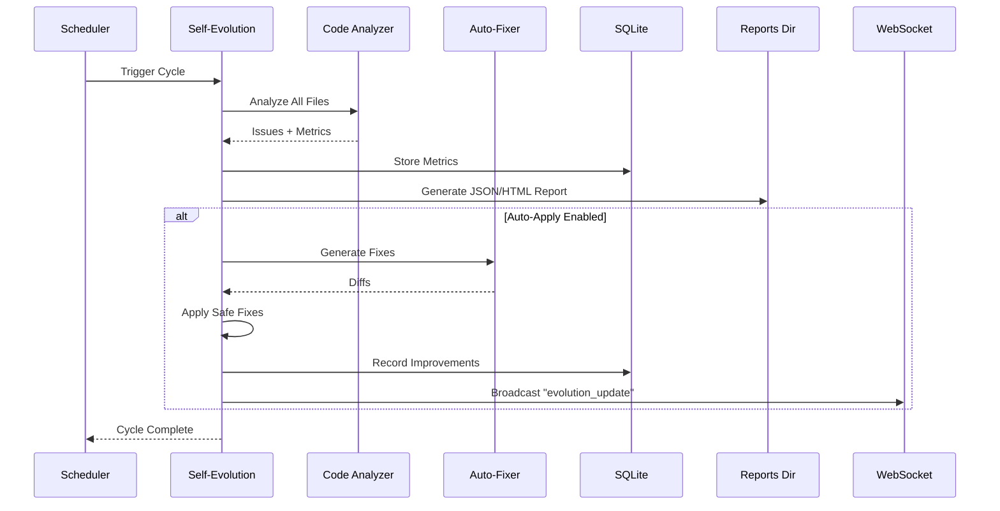
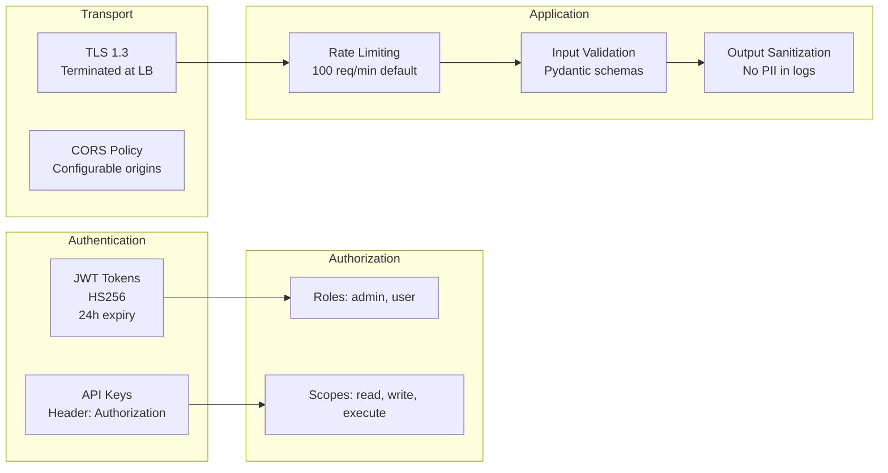

# ESPRIEAETHER-SUNNA Architecture

> **Version**: 2.0  
> **Generated**: 2026-11-20

---

## 🏛 System Architecture Diagram



---

## 🔄 Data Flow Diagrams

### Request Flow (API Bridge)



### Task Execution Flow



### Self-Evolution Flow



---

## 🧩 Component Interaction Matrix

| Component | sunna_api | sunna_executor | router | self_evolution | colibri | G0DM0D3 |
|-----------|-----------|----------------|--------|----------------|---------|---------|
| **sunna_api** | — | HTTP + WS | Calls | Reads metrics | — | — |
| **sunna_executor** | HTTP + WS | — | Calls | Triggers cycles | Calls | — |
| **router** | — | — | — | Gets feedback | — | — |
| **self_evolution** | — | Triggered by | — | — | Analyzes | — |
| **colibri** | — | Called by | — | Analyzed by | — | — |
| **G0DM0D3** | — | — | — | — | — | Standalone |

---

## 🔌 Port Allocation

| Port | Service | Protocol | Description |
|------|---------|----------|-------------|
| 5000 | Web Interface | HTTP | Main web UI |
| 5001 | Cloud Desktop | HTTP | Desktop streaming |
| 5100 | Sunna API Bridge | HTTP/WS/SSE | Company data API |
| 5105 | Sunna Dashboard | HTTP/WS | Executive Director UI |
| 8000 | Agent OS / JARVIS | HTTP | Agent orchestration |
| 11434 | Ollama | HTTP | Local LLM server |
| 11435 | Router | HTTP | Internal routing |
| 6379 | Redis | TCP | Caching/Sessions |
| 9090 | Prometheus | HTTP | Metrics scraping |
| 3000 | Grafana | HTTP | Visualization |

---

## 📊 State Management

### Sunna API State (In-Memory + Workspace Files)
- Company info (static)
- Team structure (static)
- File listings (dynamic, read from disk)
- Bot schedules (static config)
- Research agents (static config)

### Sunna Executor State (Persistent JSON + SQLite)
```json
{
  "status": "running",
  "last_veille": "2026-11-20T10:00:00Z",
  "last_prices": "2026-11-20T08:00:00Z",
  "tasks": { "task_id": { ... } },
  "metrics": {
    "tasks_executed": 42,
    "tasks_failed": 3,
    "uptime_start": "2026-11-19T00:00:00Z"
  }
}
```

### Evolution State (SQLite)
- `evolution_log`: Cycle history
- `improvements`: Applied fixes
- `code_metrics`: Complexity trends
- `performance_baselines`: Regression detection

### Router State (In-Memory + SQLite)
- `routing_history`: Last 1000 decisions
- `engine_health`: Success/error/latency per engine
- `confidence_calibration`: Learned per-engine factors

---

## 🛡 Security Architecture



---

## 📈 Scaling Considerations

### Horizontal Scaling
- **Sunna API**: Stateless, can run multiple replicas behind LB
- **Sunna Executor**: Single leader for task execution (use Redis lock)
- **Dashboard**: Sticky sessions for WebSocket, or use Redis pub/sub

### Vertical Scaling
- Increase worker threads for Flask: `threaded=True`
- Use gunicorn for production: `gunicorn -w 4 -k gevent src.sunna_api:app`

### Database
- SQLite: Single writer, multiple readers (current)
- PostgreSQL: For multi-replica deployments (future)

### Caching
- Redis for: Session storage, Rate limit windows, Task queue coordination
- In-memory: Router decisions, Engine health, Evolution metrics

---

## 🔄 Failure Modes & Mitigations

| Failure | Detection | Mitigation |
|---------|-----------|------------|
| API Bridge down | `/health/deep` fails | Dashboard shows degraded, cached data |
| Executor down | WebSocket disconnect | Auto-reconnect, task queue persists |
| Database locked | SQLite error | Retry with backoff, WAL mode |
| Model API down | Router health check | Fallback chain activation |
| Disk full | Metrics alert | Log rotation, cleanup old reports |
| Memory leak | Prometheus alerts | Restart policy, memory limits |

---

## 📝 Deployment Topology

### Development
```
localhost
├── sunna_api.py (5100)
├── sunna_executor.py (5105)
├── ollama (11434)
└── sqlite (local)
```

### Production (Single Server)
```
production-server
├── nginx (80/443) → TLS termination
├── gunicorn → sunna_api (5100, 4 workers)
├── gunicorn → sunna_executor (5105, 2 workers)
├── redis (6379)
├── ollama (11434)
├── prometheus (9090)
├── grafana (3000)
└── postgresql (5432) [optional]
```

### Production (Kubernetes)
```yaml
# See DEPLOYMENT.md for full manifests
Deployments:
  - sunna-api (3 replicas, HPA)
  - sunna-executor (1 replica, leader election)
  - sunna-dashboard (2 replicas, sticky sessions)
StatefulSets:
  - redis (1 replica)
  - postgresql (1 replica)
Services:
  - sunna-api (ClusterIP)
  - sunna-executor (ClusterIP)
  - sunna-dashboard (LoadBalancer)
Ingress:
  - api.esprieaether.com → sunna-api
  - dashboard.esprieaether.com → sunna-dashboard
```

---

## 🔮 Future Architecture Evolution

### Planned Enhancements

1. **Distributed Agent Coordination**
   - gRPC/Protobuf for inter-agent communication
   - Consensus protocols for multi-agent decisions
   - Event sourcing for audit trails

2. **Advanced ML Pipeline**
   - Online learning for router
   - Embedding-based semantic routing
   - A/B testing framework for engine selection

3. **Enhanced Observability**
   - OpenTelemetry integration
   - Distributed tracing (Jaeger)
   - Custom Grafana dashboards per component

4. **Security Hardening**
   - mTLS between services
   - SPIFFE/SPIRE for identity
   - Policy engine (OPA) for authorization

5. **Data Pipeline**
   - Kafka for event streaming
   - ClickHouse for analytics
   - Airflow for scheduled workflows

---

*Architecture documentation generated from code analysis. Update when components change.*